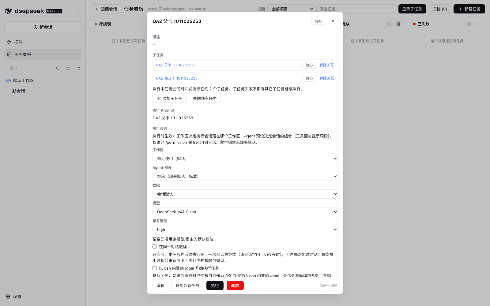
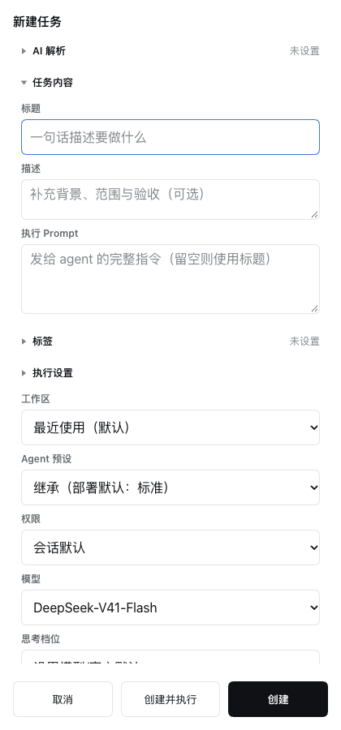

# 任务看板设置验证 — 2026-10-11

[English](task-board-settings-verification-2026-10-11.md) | 中文

## 范围与任务书

代码提交 `99721251` 的冻结验证快照。当前契约归属[思考强度决策](../../.agents/notes/implemented/feature/2026-10-11-task-board-reasoning-effort.md)与[子任务决策](../../.agents/notes/implemented/feature/2026-09-24-task-board-subtasks.md)。

| 工作项 | 边界 | 验收 |
| --- | --- | --- |
| 宿主档位链路 | 任务字段、严格协议、账本、runner 与工具 | 随模型绑定继承、清空/导入往返、新建/复用会话载荷及 Prompt 前失败 |
| 客户端控件与 Team 默认 | 任务编辑器、目录映射、GUI 成功关联及 zh/en/ru 文案 | 只可选真实档位；不乐观勾选 Team；按服务可用性启用 |
| 独立复审 | 只读源码与行为检查 | 已复现缺陷修复；异常目录与提升保护分支有覆盖 |
| 真实 GUI | 仅隔离 DSH home 与官方 CLI | 创建/关联、清空、刷新、宿主重启、无 Team 服务、桌面/窄屏布局及回收 |

实现与返工使用显式授权的 `deepseek-official/deepseek-flash` 子代理及互不重叠的文件边界；调度者负责复审、验收、文档与本地提交。子代理均未暂存或提交文件。SDK/runtime cohort 保持 `0.2.0-rc.2`，账本 schema 保持 6。

## 已记录证据

| 检查 | 结果 |
| --- | --- |
| `pnpm typecheck` | 全部 18 个包通过 |
| `pnpm test` | 3793 通过；1 项既有原生电源 smoke 跳过 |
| 看板包测试 | 1034 通过；1 项既有跳过 |
| `pnpm test:scripts` | 384 通过 |
| 新增 helper/picker 分支覆盖 | 合计 99.06%；各文件均高于 90%；客户端文件 100%，核心档位规则 95.45% |
| 构建与指纹 | `pnpm build`、`libs:write`、`libs:check`、`aggregate:check` 通过；生成的客户端 bundle 与 map 已提交 |
| 仓库门禁 | 测试规范、文档、zh/en/ru 键集、运行时依赖纯度、emoji 审计及 diff 空白检查通过 |
| 真实 GUI | 62/62 断言通过；最终已提交 bundle 的桌面流程复跑 20/20；控制台与资源错误均为 0 |

隔离账本交叉确认父卡的模型/档位组合、两项子任务的 `parentId` 以及 `teamRun: true`。清空会移除档位键，而非残留空字符串；刷新与同一隔离 profile 的宿主重启后状态仍保留。手动关闭 Team 后重开保持关闭，之后再次 GUI 成功关联会重新启用。未挂 Agent Teams bundle 的 profile 不提升父卡。

1600×1000 与 420×900 下，表单无横向溢出，label/select 左边缘偏移为 0px，操作按钮可达，键盘焦点可见；reduced-motion 采样未发现新增控件位移。KFL 静态扫描未发现新增文件问题，既有样式表告警没有被冒称修复。

所有探针已停。最终探针使用 53723 端口，由退出 trap 回收；53711/53712/53713/53721/53722/53723 随后均无监听者。用户的 880 进程与 53697 端口持续运行，未收到信号。HTTP token 只留在隔离文件中，不进入本归档。

## 限制与恢复记录

- 未执行 LLM 生成或真实 teammate 派生。官方 SDK 契约及契约 fake runner/service 测试覆盖选模载荷；卡片设置不重新定义原生 teammate 路由。
- 真实 GUI 验证了已声明档位，未额外操作过期的已存档位；其保留可见但不可选的选项由 DOM 测试与 HTML 平台契约覆盖。
- KFL 是范围内证据，不是全量认证：未量测 200% 缩放、其他视口、窄屏关联几何、完整 overlay 入场/退场对与真实触屏硬件。复用既有颜色、层级与图标契约，没有新增 CSS、自定义图标或动效实现。
- 首轮测试规范违规及 86.91% 分支覆盖已修复，未降低门槛或削弱基线。一次无关的并发运行 abort 测试出现 flaky，单独复跑与之后整仓测试通过，未改生产代码。QA helper 定位/等待问题及调度者漏传 URL 文件参数均在成功复跑前修正。
- 未推送、改版本、发布、升级 SDK 或重启用户服务。应用本地插件构建后，宿主半区改动需要用户重新加载或重启其已安装的 DSH 服务。

## 截图

